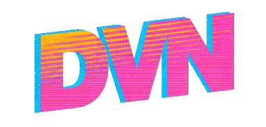

<!-- 261005 -->

  

  &nbsp;
  &nbsp;
  &nbsp;

  <h3>A command-line utility for managing development environments</h3>

<h4 align="center">

***

  [Manual](docs/man/README.md)&nbsp;&bull;&nbsp;[Changelog](docs/CHANGELOG.md)&nbsp;&bull;&nbsp;[Roadmap](docs/ROADMAP.md)&nbsp;&bull;&nbsp;[Known Issues](docs/KNOWN-ISSUES.md)

***

</h4>

| CONTENTS                          |
|:----------------------------------|
| [About DVN](#about-dvn)           |
| [The DVN manual](#the-dvn-manual) |
| [License](#license)               |

# About DVN

Let's say you have a project called "MyProject".

You're development environment for MyProject includes:

* A Visual Studio 2022/2026 solution named "**MyProject**"
* A Visual Code Code workspace named "**MyProject-Documentation**"
* A file named "**Scratchpad.txt**"
* The GitHub Desktop application
* A webpage containing API documentation

In addition, you may want to:

* Backup your project before working on it
* Update your [scoopsh](https://scoop.sh/) installation/applications.

You could do all of the above manually, ***or*** you could let **DVN** do it for you by typing: `dvn myproject`

# The DVN manual

For more information about **DVN**, including detailed usage instructions, please refer to the [manual](docs/man/README.md).

# License

Copyright &copy; 2026 [A Pretty Cool Program](https://github.com/APrettyCoolProgram)  
Distributed under the [Apache 2.0 License](LICENSE)  

---

<h6 align="center">

  [FAQ](docs/FAQ.md)&nbsp;&bull;&nbsp;[Development](docs/DEVELOPMENT.md)&nbsp;&bull;&nbsp;[API](docs/api/README.md)&nbsp;&bull;&nbsp;[Support](docs/SUPPORT.md)&nbsp;&bull;&nbsp;[Notices](docs/NOTICES.md)
  
</h6>
