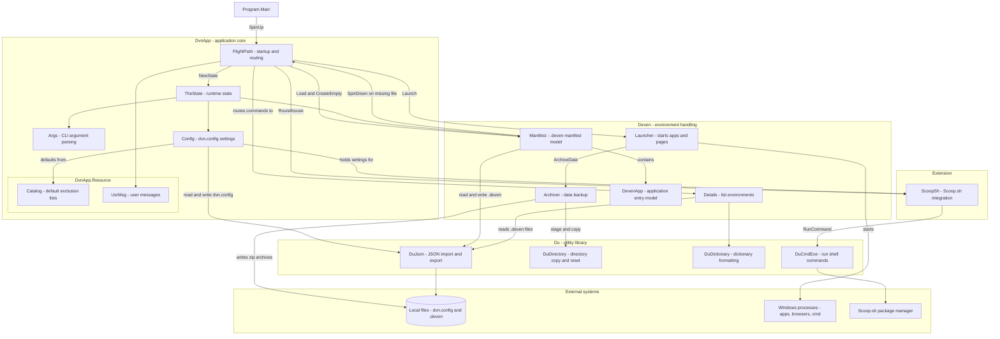
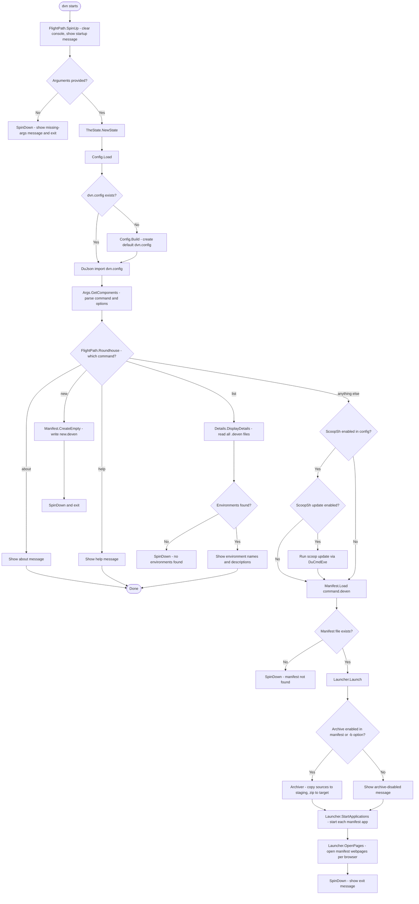

# DVN Project Flow

## CONTENTS

- [Project Structure](#project-structure) — components and their dependencies
- [Runtime Flow](#runtime-flow) — execution path from startup to exit

---

## Project Structure

This diagram shows the components of the single `dvn` console project (`dvn.csproj`) grouped by namespace, with their dependencies and external touchpoints.

**Notes:**
- There is a deliberate circular reference between `Manifest` and `FlightPath`: `Manifest.Load` calls `FlightPath.SpinDown` when a manifest file is missing.
- `UsrMsg` edges are shown only from `FlightPath` for readability; most classes also write user messages via `UsrMsg` or direct `Console.WriteLine` calls (several marked `TODO - UsrMsg`).

---

## Runtime Flow

This diagram traces execution from `Program.Main` through `FlightPath.SpinUp` and `Roundhouse`, including command routing and the environment-launch path.

**Notes:**
- Any command other than `about`, `help`, `list`, or `new` is treated as an environment name — DVN loads `.\<command>.deven` (`FlightPath.Roundhouse`).
- Archiving is enabled when either the manifest's `ArchiveEnabled` flag is `true` or the `-b` option is passed (`Archiver.IsArchiveEnabled`).
- `Launcher.OpenPages` assumes `Manifest.Webpages` is non-null; a manifest without a `Webpages` section would throw at this point — this is shown as the happy path only.
- Application launching uses `Process.Start` and is Windows-only per the remarks in `Launcher.StartApplications`.

Both diagrams were validated for Mermaid syntax. No code or project files were changed.