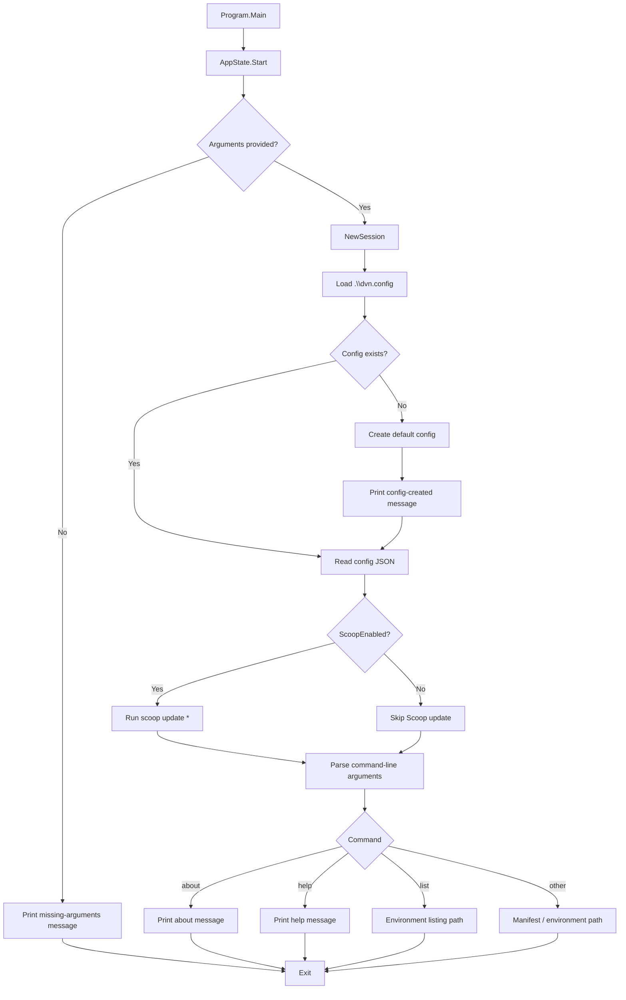
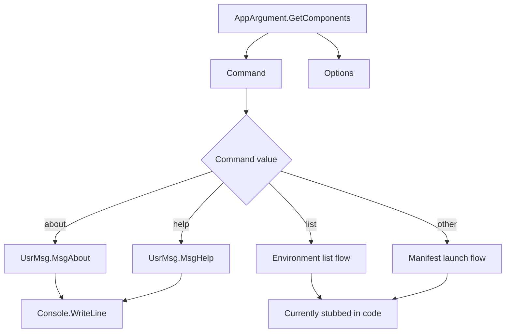
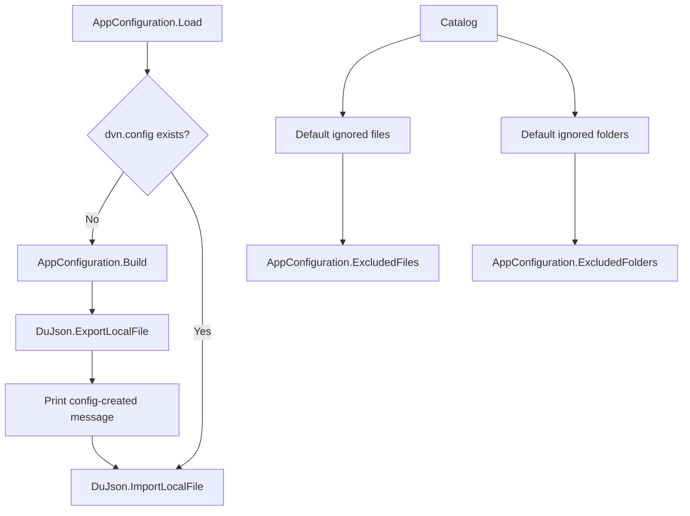
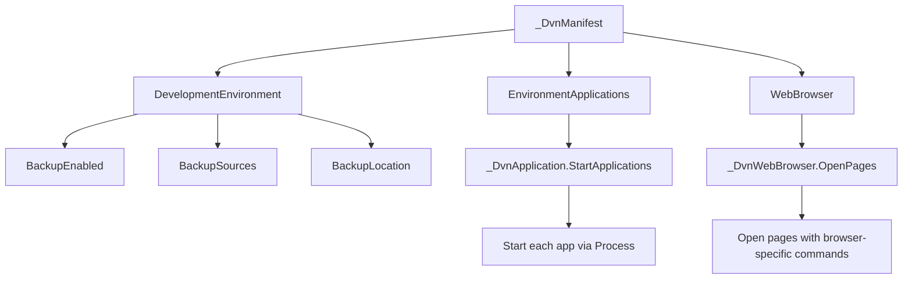
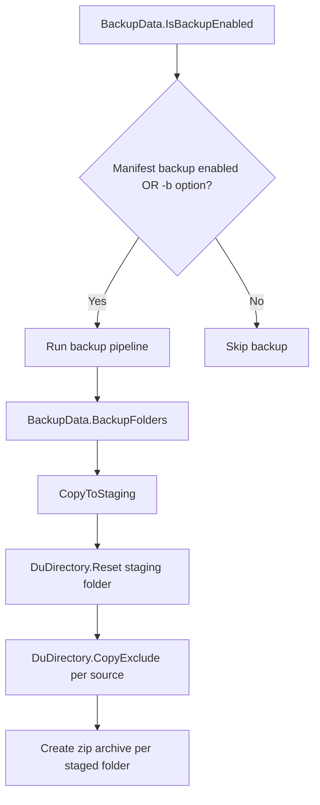
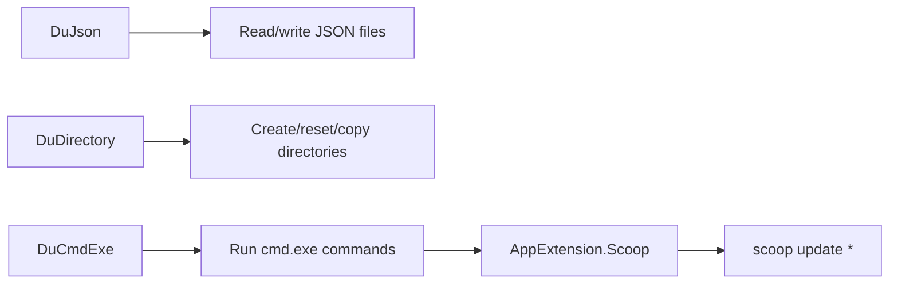

# DVN Project Flow

This page documents the current DVN codebase flow with Mermaid diagrams only.
The diagrams are based on the present source tree and the runtime paths that are
implemented today.

## Runtime flow



## Command handling



## Configuration and defaults



## Environment and manifest flow

```mermaid
flowchart TD
	A[DvnEnvironment.GetAvailable] --> B[Scan .\\manifest for *.dvn files]
	B --> C[Build environment name/description map]
	C --> D[Return Dictionary<string, string>]

	E[_DvnEnvironment.DisplayAvailable] --> F{Any environments?}
	F -- No --> G[Stop with "No environments found"]
	F -- Yes --> H[Format and print list]

	I[_DvnEnvironment.LoadFromManifest] --> J[Currently commented placeholder]
	J --> K[Future: load manifest and launch environment]
```

## Manifest runtime actions



## Backup flow



## Utility layer



## Notes

- Some environment and manifest execution paths are still placeholders in the current source.
- The diagrams describe confirmed code paths and avoid inventing behavior that is not yet implemented.
- This page is intended as a compact project-flow reference for DVN.
