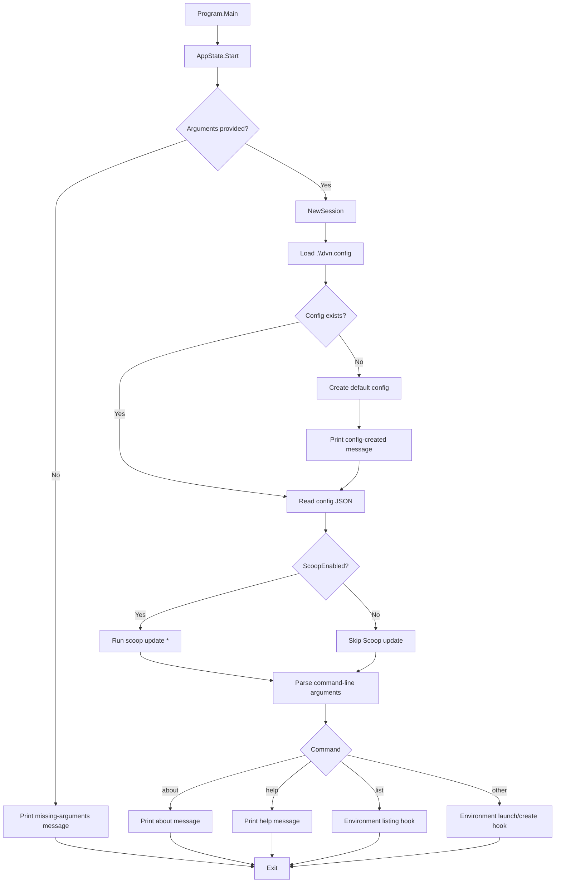
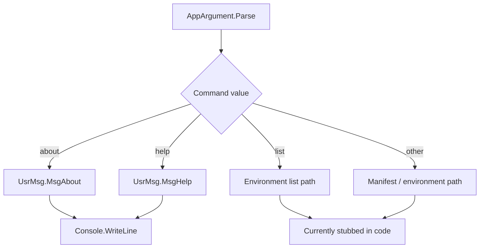
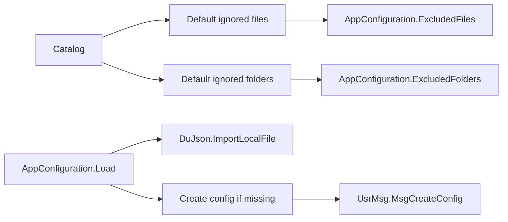
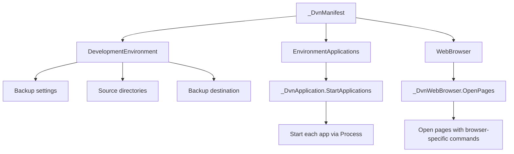
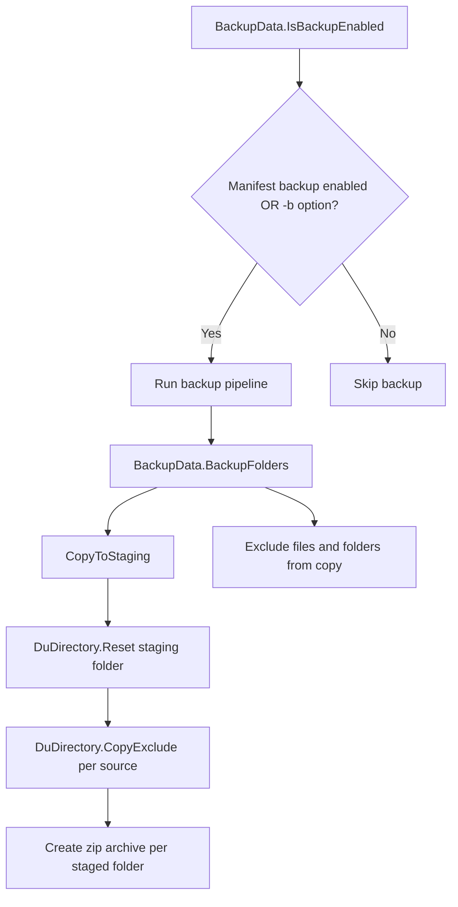
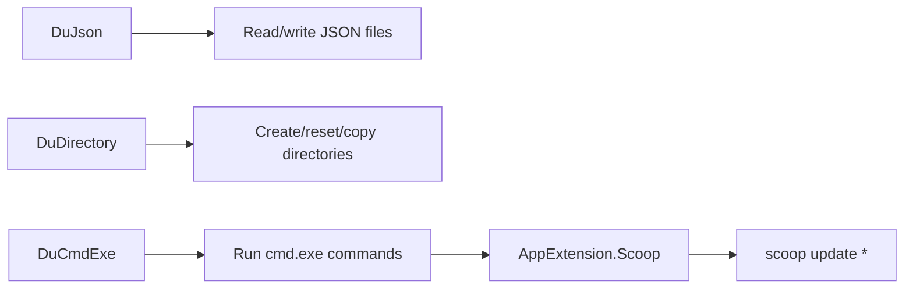

# DVN Source Code Flow

This page gives a high-level view of how the DVN codebase currently moves from startup to command handling, configuration, and the supporting utility layers.

## 1) Overall application flow



## 2) Startup and session setup

```mermaid
flowchart TD
	A[Program.cs] --> B[AppState.Start(string[])]
	B --> C[Clear console]
	C --> D[Print startup banner]
	D --> E{Any command-line arguments?}
	E -- No --> F[Stop with "Missing arguments"]
	E -- Yes --> G[AppState.NewSession]

	G --> H[AppConfiguration.Load('.\\dvn.config')]
	H --> I{Config file found?}
	I -- No --> J[Build default config]
	J --> K[DuJson.ExportLocalFile<AppConfiguration>]
	K --> L[DuJson.ImportLocalFile<AppConfiguration>]
	I -- Yes --> L

	L --> M{ScoopEnabled?}
	M -- Yes --> N[AppExtension.Scoop]
	M -- No --> O[Continue]
	N --> O
	O --> P[AppArgument.GetComponents]
	P --> Q[AppArgument.Parse]
```

## 3) Command routing



## 4) Configuration and resource flow



## 5) Manifest and environment flow

```mermaid
flowchart TD
	A[DvnEnvironment.GetAvailable] --> B[Scan .\\manifest for *.dvn files]
	B --> C[Build environment name/description map]
	C --> D[Return Dictionary<string, string>]

	E[_DvnEnvironment.DisplayAvailable] --> F{Any environments?}
	F -- No --> G[Stop with "No environments found"]
	F -- Yes --> H[Format list output]
	H --> I[Print environment list]

	J[_DvnEnvironment.LoadFromManifest] --> K[Currently commented / placeholder]
	K --> L[Future: load manifest and launch environment]
```

## 6) Manifest runtime actions



## 7) Backup flow



## 8) Utility layer



## Notes

- Several environment and manifest execution paths are still partially stubbed in the current source.
- The diagrams above show both implemented behavior and the intended flow where the code contains placeholders.
- If you want, this page can be expanded later into a more detailed architecture map or sequence diagram.
